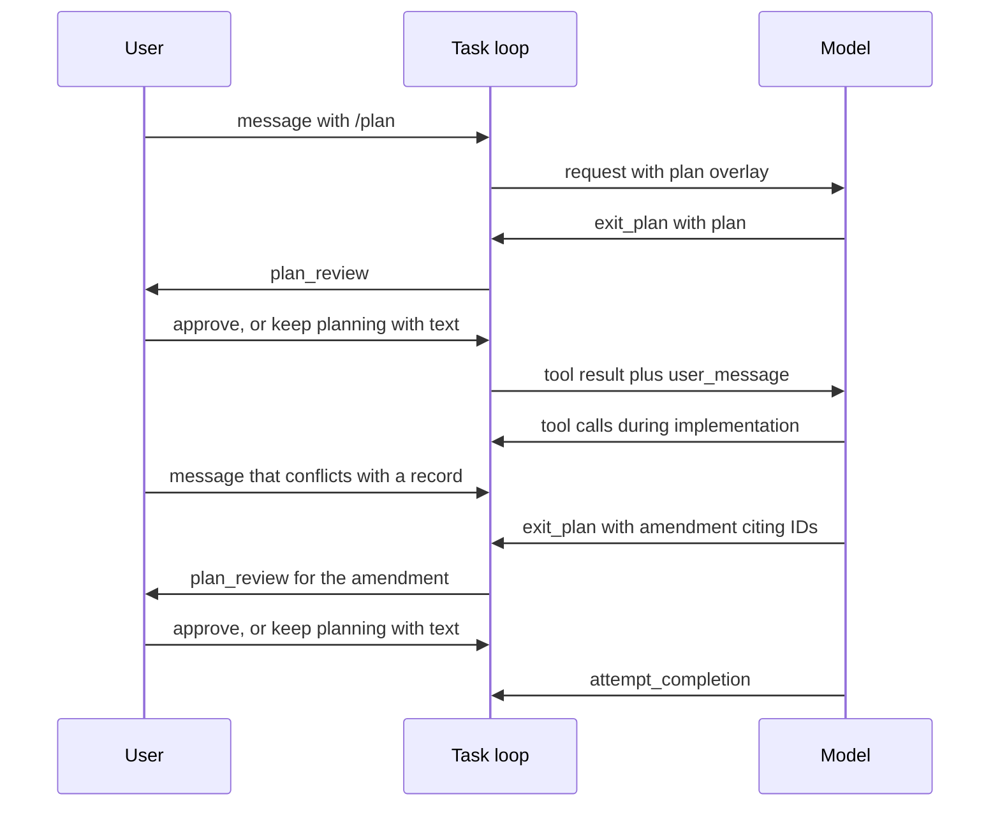

# Roo Code architecture (arc42 index)

This index covers the 12 arc42 sections. Each section links to the document that owns it. Record IDs and formats are defined in [`RECORD-FORMAT.md`](RECORD-FORMAT.md). Architect mode owns this folder. Other modes report drift and do not edit it.

| #   | arc42 section            | Owner document                                                                                                                                                                                                 |
| --- | ------------------------ | -------------------------------------------------------------------------------------------------------------------------------------------------------------------------------------------------------------- |
| 1   | Introduction and goals   | This file (below) and [`quality.md`](quality.md)                                                                                                                                                               |
| 2   | Architecture constraints | [`constraints.md`](constraints.md)                                                                                                                                                                             |
| 3   | Context and scope        | This file (below)                                                                                                                                                                                              |
| 4   | Solution strategy        | Accepted decisions in [`decisions/accepted/`](decisions/accepted/)                                                                                                                                             |
| 5   | Building block view      | This file (below)                                                                                                                                                                                              |
| 6   | Runtime view             | [`../task-state.md`](../task-state.md), [`../context-budget.md`](../context-budget.md), [`../subtask-handoffs.md`](../subtask-handoffs.md), [`../mode-model-selection.md`](../mode-model-selection.md)         |
| 7   | Deployment view          | [`../release-updates.md`](../release-updates.md), [`../../README.md`](../../README.md)                                                                                                                         |
| 8   | Cross-cutting concepts   | [`../snapshot-storage.md`](../snapshot-storage.md), [`../context-recovery.md`](../context-recovery.md), [`../project-memory.md`](../project-memory.md), [`../checkpoint-restore.md`](../checkpoint-restore.md) |
| 9   | Architecture decisions   | [`decisions/`](decisions/) (`proposed/`, `accepted/`, `rejected/`, `superseded/`)                                                                                                                              |
| 10  | Quality requirements     | [`quality.md`](quality.md)                                                                                                                                                                                     |
| 11  | Risks and technical debt | [`risks.md`](risks.md)                                                                                                                                                                                         |
| 12  | Glossary                 | This file (below)                                                                                                                                                                                              |

## 1. Introduction and goals

Roo Code is a VS Code extension that runs an AI coding agent. The agent works in modes (Architect, Code, Ask, Debug, Orchestrator, custom modes), calls tools under user approval, and delegates subtasks. This fork (`feat/cordis-refactor`) adds the Cordis preview runtime, durable task state, request snapshots, and overflow-only context recovery.

### 1.2 Quality goals

Top quality goals in priority order. Tags follow the [Q42 quality model](https://quality.arc42.org). Scenarios and status are in [`quality.md`](quality.md); all were confirmed by the user on 2026-11-20.

| Priority | Quality goal | Goals                                                                                                        |
| -------- | ------------ | ------------------------------------------------------------------------------------------------------------ |
| 1        | #reliable    | Task history survives upgrades and rollbacks; recovery is bounded and reversible (Q-REL-1, Q-REL-2, Q-REL-3) |
| 2        | #secure      | Repository content is lower-trust data; secrets are not exposed (Q-SEC-1, Q-SEC-2)                           |
| 3        | #efficient   | Context cost stays predictable; prompt-cache reuse is kept (Q-EFF-1)                                         |
| 4        | #usable      | Mode changes keep the model (Q-USE-1)                                                                        |
| 5        | #efficient   | Cordis profile costs no more than the modes profile (Q-EFF-2)                                                |

## 3. Context and scope

- Users interact through the webview (`webview-ui/`) inside VS Code or code-server.
- The extension host (`src/`) calls model providers (Anthropic, OpenAI, Bedrock, Gemini, OpenRouter, local servers, and others) over HTTPS.
- MCP servers, terminals, the browser bridge (`apps/browser-bridge/`), and the workspace file system are external systems that tools reach.
- Task data lives in VS Code global storage. The extension never migrates or deletes it ([C-5](constraints.md)).
- Subtasks run in the parent task's workspace folder, one at a time. A per-subtask choice between a shared and an isolated workspace is proposed ([R-7](risks.md)).
- Evaluation operator (development only): a person or a separate Roo task that runs the scenarios in [`evaluation-2026-11-18.md`](evaluation-2026-11-18.md) against an installed build, in a separate workspace snapshot for each run.

## 5. Building block view

| Block                       | Location                                             | Responsibility                                                    |
| --------------------------- | ---------------------------------------------------- | ----------------------------------------------------------------- |
| Shared types                | `packages/types/`                                    | Settings, messages, modes, provider models                        |
| Extension host              | `src/extension.ts`, `src/activate/`                  | Activation, commands                                              |
| Provider and webview bridge | `src/core/webview/`                                  | `ClineProvider`, webview message handling, task lifecycle         |
| Task loop                   | `src/core/task/Task.ts`                              | Request loop, tool dispatch, context injection, overflow recovery |
| Model operation storage     | `src/core/task/model-operation/`                     | Request snapshots and admission                                   |
| Context management          | `src/core/context-management/`, `src/core/condense/` | Overflow recovery, summaries, truncation fallback                 |
| Tools                       | `src/core/tools/`, `src/core/prompts/tools/`         | Tool handlers, native tool definitions, mode filtering            |
| Prompts                     | `src/core/prompts/`                                  | System prompt sections                                            |
| Services                    | `src/services/`                                      | Task state, memory, MCP, checkpoints, updates, browser            |
| API handlers                | `src/api/`                                           | Provider adapters, dispatch admission, Cordis preview runtime     |
| Webview UI                  | `webview-ui/`                                        | React chat and settings UI                                        |

## 6. Runtime view: Cordis plan and drift amendment

The other runtime flows are in the documents listed in the index. This is the Cordis profile flow ([ADR-2026-11-19-keep-cordis-profile-widen-experiment](decisions/accepted/ADR-2026-11-19-keep-cordis-profile-widen-experiment.md)).

A reply without a tool call gets one reminder before the task pauses (`cordisTextOnlyTurnPolicy`, default `retryThenPause`). On providers other than Anthropic there is no dispatch runtime, so the normal reminder path applies ([R-5](risks.md)).

## 12. Glossary

| Term              | Meaning                                                                                                    |
| ----------------- | ---------------------------------------------------------------------------------------------------------- |
| Mode              | A named preset of role instructions and tool groups                                                        |
| Task              | One conversation with its API history, UI messages, and storage directory                                  |
| Ledger            | The task-state store of goal, decisions, work items, and evidence ([`../task-state.md`](../task-state.md)) |
| Overflow recovery | Context reduction that runs only after the provider rejects a request for size                             |
| Cordis profile    | Task profile used when experiment `cordisRuntimePreview` is on at task creation                            |
| Drift             | Code or plan that conflicts with an accepted constraint, decision, or quality goal                         |
